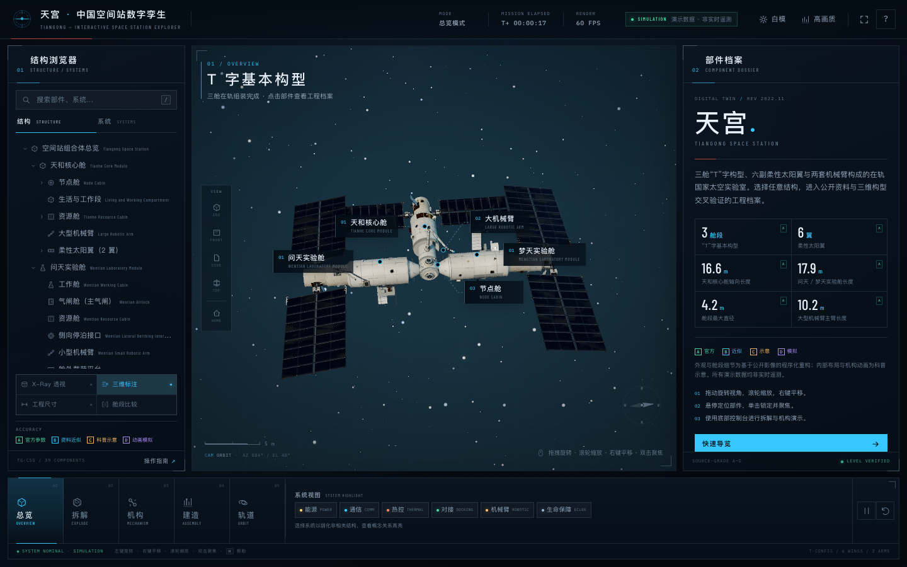

# 天宫 · 中国空间站数字孪生与结构探索系统

**TIANGONG — INTERACTIVE SPACE STATION EXPLORER**

一个基于原生 HTML / CSS / JavaScript 与 Three.js 的中国空间站交互式三维数字孪生展项。三舱 T 字构型、六套柔性太阳翼、两套七自由度机械臂、多级结构拆解、在轨组装时间轴与轨道观察，全部由程序化几何实时构建，不加载任何外部 3D 模型文件。



## 运行

**方式一：直接打开**

双击 `index.html` 即可运行（`file://` 本地文件模式已实测）。所有脚本、字体、纹理均为本地资源，不依赖后端或外部 CDN。

**方式二：本地开发服务器**

```bash
npm install        # 首次安装构建依赖
npm start          # http://127.0.0.1:4173/
```

**重新构建 `app.js`**

```bash
npm install
npm run build
```

入口源码为 `src/main.js`，通过 esbuild 打包为本地经典脚本 `app.js`，因此最终页面无需 ES Module 服务器即可打开。Three.js 版本为 r169。

## 主要功能

- **程序化空间站模型**：天和核心舱、问天实验舱、梦天实验舱，按 2022 年 11 月三舱 T 字基本构型在轨装配；含节点舱、对接口/停泊口、舱段过渡环、多层隔热包覆、舷窗、舱门、散热器、天线、机械臂、太阳翼驱动机构、舱外载荷平台等。
- **六套柔性太阳翼**：天和 2 × 约 67 m²，问天/梦天各 2 × 约 138 m² 级；折叠展开采用多节刚性阵板与伸缩桅杆的机械式联动，而不是整体缩放；每套翼根部均通过舱壁鞍座、主承力梁、双撑杆、根部法兰和电缆走向连接到所属资源舱；支持逐翼展开/收拢、进度与速度控制、单翼受光角演示。
- **两套机械臂**：约 10.2 m 大臂与约 5 m 小臂，各 7 自由度；关节滑杆带真实限位，支持展开、收拢、巡检、初始四组预设姿态，以及自动演示。行架、关节、末端执行器与相机/照明均为程序化细节。
- **多级结构拆解**：0–100% 连续滑块；L1 舱段 / L2 分区 / L3 关键设备三层拆解；全部拆解、全部组装、分步、暂停/继续、仅拆当前选中部件；爆炸位移全部由基础变换重新计算，不会累计漂移。
- **在轨建造历程**：6 个公开任务节点，展示天和入轨、问天对接与转位、梦天对接与转位，最终形成 T 字构型；为科普重现，不是轨道动力学模拟。
- **轨道观察**：程序化地球（大陆、海洋、云层、晨昏线、城市灯光示意）、大气辉光、空间站视角追踪、自动巡航与太阳方位控制。
- **部件档案**：39 个部件/系统记录，支持射线拾取、结构树定位、搜索、显示/隐藏、关联部件跳转、公开资料来源、A–D 真实性分级。
- **系统高亮**：能源、通信、热控、对接、机械臂、环控生保六种语义高亮，非相关结构淡化并绘制概念关系轮廓。
- **X-Ray 透视**：舱壁与外部设备半透明化，显示概念化舱内机柜、通道与设备布局；内部结构明确标注为科普示意。
- **工程尺寸与标注**：按公开参数绘制三舱长度和最大直径尺寸线；三维锚点 + SVG 引线标注，支持优先级与防重叠布局。
- **舱段比较**：问天 / 梦天 / 天和两两对比，已知信息与“公开资料未确认”项分别呈现。
- **深色 / 白模双主题**：深色任务控制台与工程白模，同步更新场景、灯光、材质、标注与全部 UI；白模附带工程基准网格。
- **性能与响应式**：高画质 / 性能两档；桌面三栏、平板抽屉与可折叠控制台、移动端抽屉与紧凑控制台；支持触摸旋转/缩放与键盘操作。

## 交互速览

| 操作 | 效果 |
| --- | --- |
| 鼠标左键拖动 / 单指拖动 | 旋转视角 |
| 滚轮 / 双指捏合 | 缩放 |
| 鼠标右键拖动 | 平移 |
| 单击部件 | 选中并聚焦，打开部件档案 |
| 双击部件 | 快速聚焦 |
| 单击空白处 / Esc | 取消选择 |
| `1`–`5` | 总览 / 拆解 / 机构 / 建造 / 轨道 |
| `Space` | 暂停 / 继续所有机构动画 |
| `F` | 聚焦当前部件 |
| `X` | X-Ray 透视 |
| `L` | 显示 / 隐藏三维标注 |
| `R` | 复位视角与状态 |
| `H` / `?` | 操作帮助 |

## 目录结构

```
index.html                 页面结构与全部 UI 容器
src/
  main.js                  应用编排、模式与状态管理
  style.css                完整界面与主题样式（本地字体）
  scene/                   渲染器、相机、光照、后处理、空间环境、视觉状态
  models/                  程序化材质、舱体细节、空间站装配、太阳翼、机械臂、网格合并优化
  interaction/             射线拾取、多级拆解
  simulation/              太阳翼、机械臂、在轨组装、轨道控制
  ui/                      结构树、档案、标注、尺寸线、控制台绑定
  data/                    部件内容、来源登记
app.js                     最终浏览器可运行的打包文件（构建产物）
assets/fonts/              Barlow Condensed / IBM Plex Mono 本地字体
docs/RESEARCH.md           资料依据与真实性说明
tests/                     Puppeteer 回归测试脚本
screenshots/               最终效果截图
```

## 真实性与资料来源

- 页面中每个部件的档案均标注 **A / B / C / D** 真实性等级：
  - **A** 官方参数：公开官方资料可确认的尺寸、构型、日期与功能；
  - **B** 公开资料近似：依据官方影像和公开报道推断的比例与外观；
  - **C** 科普示意：舱内布局、机柜、管线和设备概念化表现；
  - **D** 动画模拟：太阳翼展开、机械臂运动、在轨组装与轨道演示。
- 精确数值采用公开范围并注明来源；无法确认的数据统一写作“公开资料未确认”，不虚构内部零件数、遥测或专有参数。
- 页面顶部与帮助中均注明：**所有遥测、运行状态、机构动作均为演示数据，不是实时遥测，不代表任何航天机构的官方发布。**
- 主要公开来源入口：
  - 中国载人航天工程网：<https://www.cmse.gov.cn/>
  - 中国国家航天局：<https://www.cnsa.gov.cn/>
  - 空间站总体构型资料（项目资料提供）：<https://www.cnsa.gov.cn/n6758823/n6758838/c10087703/content.html>
  - 空间站研制与建造资料（项目资料提供）：<https://www.cmse.gov.cn/hdjl/bszjhd/bjzl/202301/t20230117_52275.html>
  - 柔性太阳翼介绍（项目资料提供）：<https://www.cmse.gov.cn/xwzx/202211/t20221107_51357.html>
- 更详细的来源状态、确认项与重构说明见 [`docs/RESEARCH.md`](docs/RESEARCH.md)。

## 验证说明

使用 Chrome 156 + Puppeteer 做了桌面与移动端回归，覆盖：

- 页面加载、三舱渲染、标注布局与相机数值；
- 结构树选择、搜索、系统高亮、X-Ray、白模主题、工程尺寸；
- 射线拾取、悬停提示、三维选择；
- 六套太阳翼根部结构连接审计（A/B 翼与三舱资源舱）；
- 拆解滑块、全拆/全装、单部件拆解；
- 太阳翼展开/收拢与进度联动、7 关节滑杆、预设姿态、自动演示；
- 建造时间轴与 T 字构型完成状态；
- 轨道模式地球与自动巡航；
- 帮助/比较弹窗、键盘快捷键、性能模式、重置；
- `file://` 直接打开、390 × 844 手机与平板布局、无横向溢出、无运行时错误。

结构复核同时覆盖了外部载荷平台、两套机械臂基座、展开式载荷平台、对接/停泊口及停靠飞船等外部装配关系；对发现的支撑缺失一并补齐。

桌面端高画质在测试机（Apple M4 / Chrome Metal）上稳定约 58–60 FPS；性能模式会进一步降低像素比并关闭实时阴影和后处理。

## 说明

本项目为独立的科普交互展项与程序化三维重构，不是官方工程软件，也不含真实飞行遥测、工程图纸或专有数据。Three.js 按 MIT 许可证使用。
